# Lab 01: CI/CD con GitHub Actions y Amazon ECS
 
Nombres: Kelly Johana Solano Calderón (ksolanoc@unal.edu.co) \
Curso: Fundamentos de DevOps y SRE \
Fecha: 10 de octubre de 2026

---

## Arquitectura de contenedores
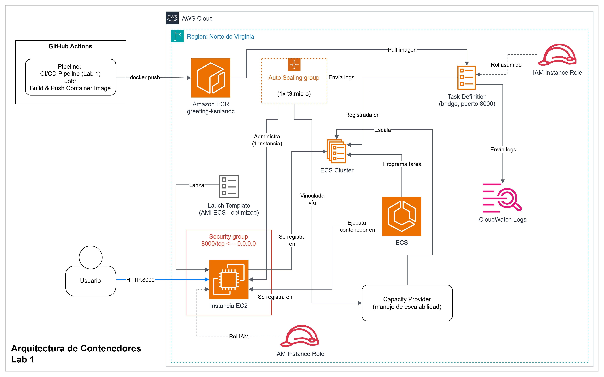

El presente laboratorio se enfocaba en automatizar el ciclo de integración y desplieuge continuo (CI/CD) de una aplicación de Python con FastAPI contenerizada hacia infraestructura de AWS. Esta aplicación permite el envio de saludos usando unos parámetros para el nombre y el apellido. Esta se empaqueta utilizando un contenedor de Docker, definido en un archivo Dockerfile que incluye:
- Uso de una imagen ``python:3.12-slim``, que es liviana dado que no se requieren cargar herramientas específicas del sistema operativo y es segura según el alcance del proyecto.
- Uso de ``poetry install --only main`` como instalación única de dependencias en producción para construir una imagen más liviana y dar más seguridad, al reducir la superficie de ataque del contenedor en producción.
- Exposición del puerto 8000 y ejecución de la aplicación usando ``uvicorn``.

El proveedor de infraestructura en la nube seleccionado es AWS. En el se seleccionan varios servicios que permitiran gestionar el despliegue de la imagen de Docker.

- **ECR (Elastic Container Registry)**: permite registrar e implementar imágenes de contenedores Docker. El uso de este servicio se basa en que GitHub Actions no tiene una conexión directa con la infraestructura de AWS, ni con una instancia que aloje el proyecto. Por eso, se construyó un job de CI que facilita esa conexión a través de comandos ``docker push`` para subir la imagen a ECR, y ``docker pull`` desde otro servicio llamado ECS para que al correr una Task Definition, pueda obtener esa imagen. Esto facilita el desacoplamiento asíncrono desde GitHub Actions hacia AWS. Otro punto importante, es que ECR permite el versionamiento y trazabilidad de las imágenes, ya que las etiqueta con el SHA del commit. Adicionalmente, cada operación de push y pull tiene control de acceso vía IAM (porque se envía con las credenciales de AWS y se definen Task Execution Role para su descarga). 

- **ECS (Elastic Container Service)**: Una vez la imagen está en ECR, necesita ejecutarse en algún lado. En este laboratorio se usa un modelo ECS sobre EC2, donde se define cómo la instancia se va a lanzar. Para ello, se especifica en una Launch Template, el tipo de instancia, el rol IAM y el grupo de seguridad a utilizar. Algo importante es que dentro de los datos se define el clúster donde va a estar la instancia (``cluster-ksolanoc``). Se añade también un Auto Scaling Group, el cual se vincula al clúster de ECS con un Capacity Provider con managed scaling habilitado, para mantener siempre una sola instancia activa. A nivel de diseño, esto permite que, si se quieren aumentar las instancias, se pueda escalar sin tener que cambiar la estrategia. 

- **Orquestación ECS**: Dentro de ECS, se definen Task Definitions que declaran la red interna de las instancias. En este caso están en modo ``bridge`` para hacer un mapeo explicito de los puertos ``containerPort/hostPort``, que definen los accesos visibles hacia afuera y hacia adentro en la instancia. El lanzamiento de esta tarea la realiza el ECS Service, que garantiza que la cantidad de instancias siga siendo de 1, y que la tarea continue operando. 

- **Seguridad**: Se define un Segurity Group para la instancia que abre el puerto 8000/tcp desde 0.0.0.0/0. Esto define el tráfico de red que puede llegar a la instancia, sin importar quién lo envía. También se define los roles a través de IAM, como control a nivel de permisos. Para ello hay dos roles: 1) Instance Role, que lo asume EC2 y es con el que se registra en ECS, y 2) Task Execution Role, que lo asume ECS y le permite hacer pull de ECR y escribir los logs. Se destaca que cada rol se rige bajo el "mínimo privilegio".  

- **Observabilidad**: Los logs se centralizan en AWS con CloudWatch fuera de la instancia, para mantener la trazabilidad del proceso. 

## Conceptos de CI/CD

Algunos de los conceptos de CI/CD aplicados al laboratorio son:

 - Integración continua (CI): Es la validación del código automáticamente antes de integrarlo. Se aplica en los jobs de Lint y Test del pipeline ``ci.yml``.
 - Entrega continua (CD): Permite automatizar el paso del código validado a su despliegue en producción. Se aplica dentro de los jobs de Build and Push y Deploy, que se disparan automáticamente al hacer push a la rama Main.
 - Pipeline as Code: Los flujos de CI/CD se definen como archivos versionados dentro del repositorio, sin necesidad de configurar dentro de la UI de GitHub Actions. 
 - Quality Gate (puerta de calidad): Refiere a la característica de detener el pipeline de forma automática cuando algo falla (por ejemplo, una validación), antes de pasar a las etapas posteriores. Se aplica en la instrucción ``needs: [lint, test]``, que bloquea el Build and Push, si cualquiera de esos dos falla.
 - Gating por rama: Restringe los eventos que se pueden disparar en las ramas. Por ejemplo, en el build y el deploy, se define que solo se ejecute si el push se realiza a Main o si se dispara manualmente (con ``workflow_dispatch``) y no cuando se abre un Pull Request.
 - Gestión de secretos: Las credenciales necesarias para ingresar a AWS no viven en el código sino que se van inyectando en tiempo de ejecución desde un vault seguro. Esto se gestiona a través de GitHub Secrets.
 - Idempotencia: Cada vez que se ejecutan los pipelines se obtiene el mismo resultado, sin duplicar o borrar algun tipo de configuración previa. Esto se define dentro de los archivos de comandos ``deploy.sh`` y ``destroy.sh`` que siempre verifican si los recursos ya existen antes de crearlos o eliminarlos. 
 - Versionamiento: Cada build de la aplicación crea una versión identificable y no modificable. Esto se logra cuuando se etiqueta cada build con el tag ``$IMAGE_SHA`` que vincula las imágenes con el SHA del commit asociado. 

## Ejecución del pipeline en GitHub Actions

A continuación se presentan las evidencias de la ejecución exitosa de los Pipelines.

### Pipeline automático para el despliegue

Vista de ejecuciones
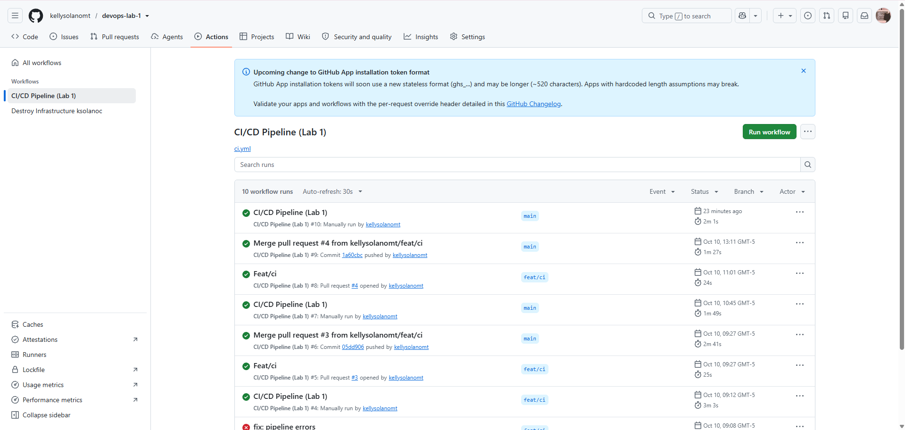

Vista general del workflow
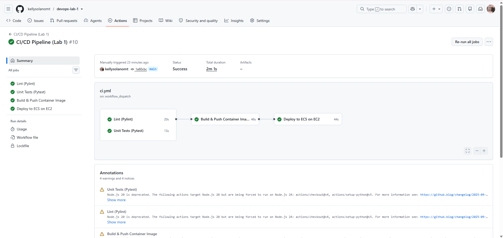

Vista del job Lint
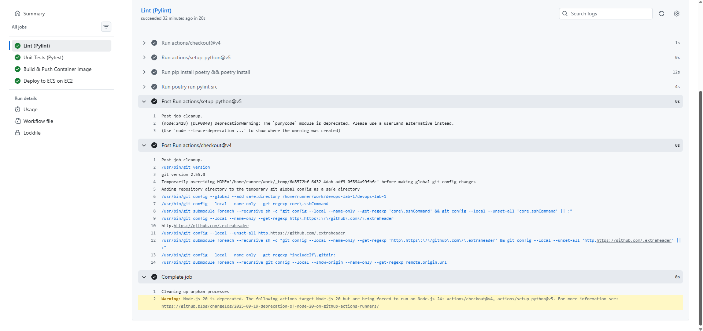

Vista del job de Test
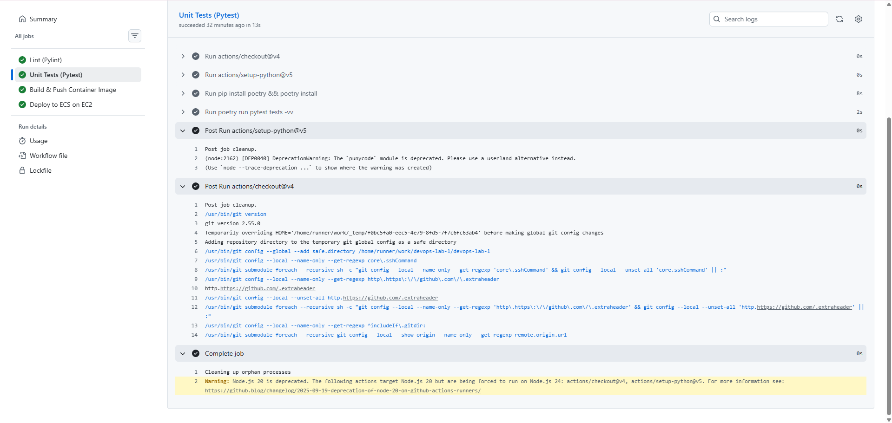

Vista del job de Build & Push
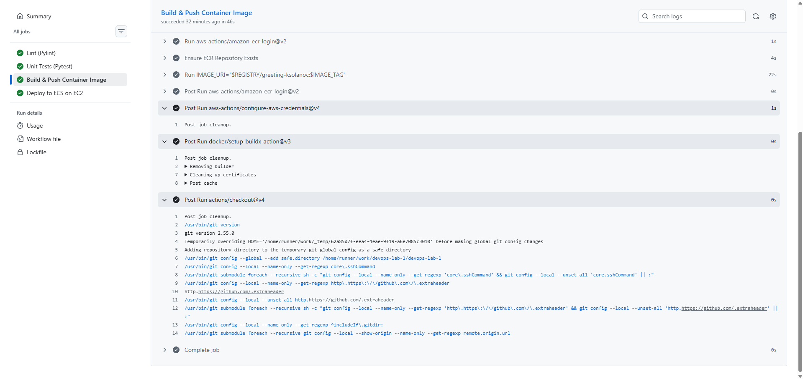

Vista del job de Deploy
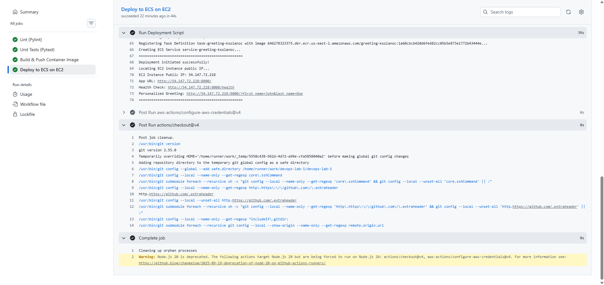

### Pipeline manual para eliminar la infraestructura

Vista de ejecución 1
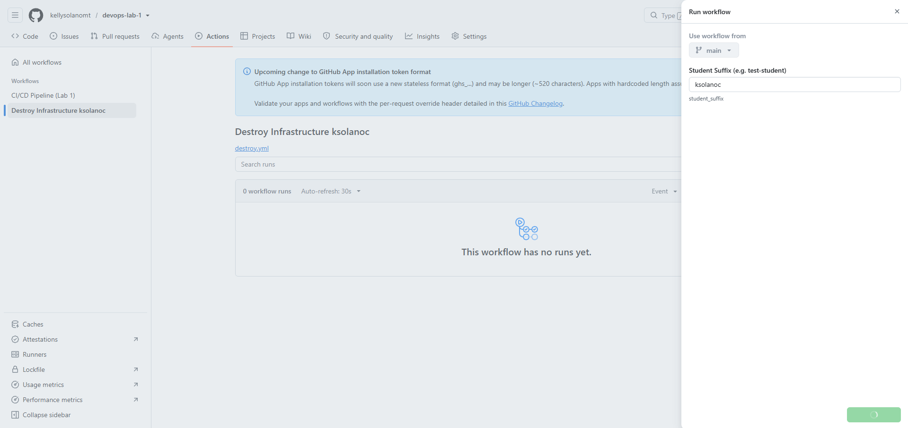

Vista de ejecución 2
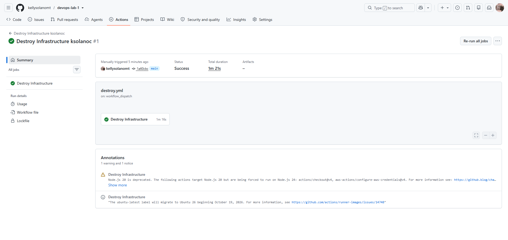

Vista del job de Destroy
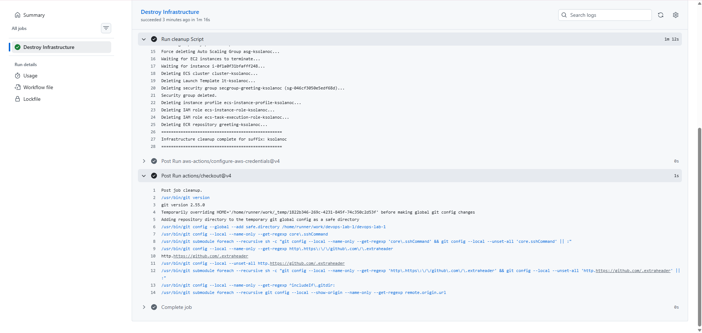

## Petición HTTP a la IP pública de la instancia

Petición HTTP realizada a la instancia a través de curl.
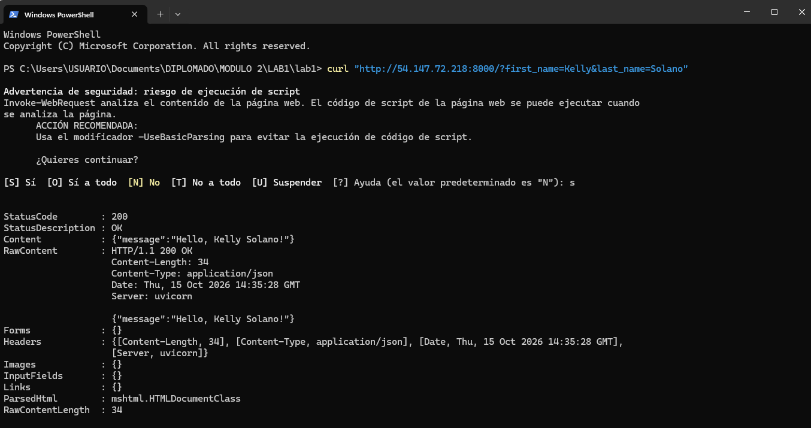

## Propuestas para mejorar el pipeline

- Agregar paso de escaneo de vulnerabilidad en la imagen: Dentro del job ``build_and_push`` únicamente se está construyendo y subiendose la imagen, sin ninguna revisión hacia la versión construida o las dependencias que utiliza para verificar que no tenga vulnerabilidades del tipo CVE (Common Vulnerabilities and Exposures). Para esto, se puede agregar un paso de escaneo antes de hacer el push, donde se habilite el ECR enhanced scanning (que es nativo de AWS) o se integre una herramienta como Trivy en el workflow, que hace que falle el pipeline cuando cuenta vulnerabilidades críticas.

- Restringir el Security Group: Actualmente cualquier IP de internet puede llegar directo al puerto de la aplicación que está en el EC2. Para poner en práctica medidas de seguridad, se podría utilizar un Application Load Balancer delante de la instancia, y que el Security Group de esta solo acepte el tráfico desde el Security Group del Load Balancer, que actuará como única puerta de entrada expuesta a internet.

- Agregar pruebas post-despliegue (smoke test): En el último job de Deploy, solamente se corre el script ``deploy.sh``. El pipeline finaliza como exitoso solo cuando el script de AWS CLI termina sin errores, pero no se comprueba que realmente una petición HTTP responda bien. La propuesta es agregar un paso final post-despliegue, para que cuando se tenga esa IP pública, se haga un curl que apunte hacia ``/health`` para revisar la salud de la instancia. El objetivo es que falle el pipeline si no se recibe una respuesta válida. Adicionalmente se podría definir un rollback del pipeline para este escenario. 
